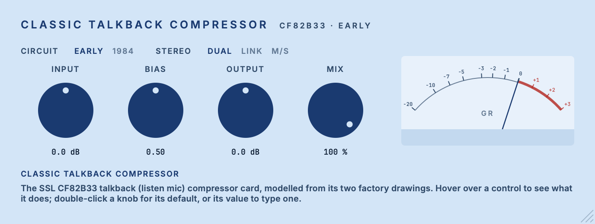

# Classic Talkback Compressor

Inspired by the SSL CF82B33 talkback (listen mic) compressor card.

Part of the codycodie plug-in collection.

Classic Talkback Compressor models the talkback compressor card of an SSL 4000 console from its two
factory drawings: the early CF82B33 sheet and the T82033.71 rev 6a sheet of April 1984, switchable as
**Early** and **1984**. The card is a feedback limiter: a biased JFET shunt attenuator driven by a
rectifier and a storage capacitor, inside a narrow band of about 290 Hz to 4 kHz. The plug-in solves
a reduced form of that circuit at 4x oversampling, built from the drawn component values. It is an
independent model, checked against a circuit simulation of the full card; it is not a measurement of
a particular unit.



Identity: product `Classic Talkback Compressor`, company `codycodie`, bundle identifier
`com.c0dypeng.classictalkbackcompressor`, manufacturer code `Cdpg`, plug-in code `CtCp`. AU and VST3,
mono or stereo, 4x oversampling (fixed), a latency of 44 samples at every sample rate. The IDs,
ranges and choice orders below are permanent; the saved state is versioned.

## Downloads

Get the latest builds from [GitHub Releases](https://github.com/chijenpeng/classic-talkback-compressor/releases/latest).
The macOS package contains universal AU and VST3 plug-ins for Apple Silicon and Intel Macs; it is
ad-hoc signed and not notarized. The Windows package contains an unsigned x64 VST3.

## Controls

| Control | Range | What it controls |
|---|---|---|
| Circuit | Early / 1984 (default Early) | The early CF82B33 drawing or the T82033.71 rev 6a sheet. Switching while audio plays crosses over in 60 ms between the two circuits. Rev 6a feeds audio to the JFET gate down to about 34 Hz (Early: about 1.6 kHz), so it is far cleaner under compression (THD at 1 kHz with 10 dB of reduction: about 19 % on Early, about 1 % on 1984). Its detector capacitor is two thirds the size, so after a large overload it recovers about a third faster (gate t63 about 42 ms against 57 ms after a +20 dB step). |
| Input | −24 … +24 dB (default 0) | Level into the card. At 0 dB a 1 kHz sine at −18 dBFS RMS gives 10 dB of gain reduction on Early at Bias 0.5. The preamp starts to clip about 20 dB above that point (19 dB on 1984): at Input +15 dB, peaks above about −10 dBFS. |
| Bias | 0.30 … 1.00 (default 0.50) | The card's bias trim, shown as the trim position. It moves the threshold (0.30 starts reducing about 12 dB below 0.50; 1.00 about 9 dB above) and, at the same amount of reduction, the character: low settings are gentler, slower to release, cleaner and keep more headroom before the preamp clips; high settings are harder, faster and clip sooner. |
| Output | −24 … +24 dB (default 0) | Level after the card, before Mix. At the defaults the same sine leaves at −18 dBFS RMS on Early. |
| Mix | 0 … 100 % (default 100) | Dry input, delayed to match the latency exactly, against the processed signal. Mix 0 is the input delayed by the latency, bit for bit. The card has no mix control. |
| Stereo | Dual / Link / M/S (default Dual) | Dual runs two independent cards. Link ties the two cards' detector capacitors and solves them together, so both channels receive the gain reduction of the louder side. M/S compresses mid and side (M = (L + R) / 2, S = (L − R) / 2). Engaging or releasing Link and M/S has no step. Mono tracks ignore it. |
| Gain-reduction needle | Indicator | The engine's own estimate of the JFET attenuator's reduction, on a VU-style face with 65 ms ballistics. It has no numeric readout. |

Every control and the needle carry hover help. The window scales from 0.75x to 2x.

### What was chosen for this plug-in

The card works in volts and has no input or output level control, no mix and no stereo operation.
These parts are decisions of this plug-in, not taken from the hardware:

- **Input and Output alignment.** 0 dB at Input means 0.011654 V of source EMF at the mic input per
  unit of sample value (full scale = peak 1.0), the same for both circuits; 0 dB at Output means
  16.005 V at the card's output per unit of sample value. They were set so that the −18 dBFS RMS
  sine described above gives 10 dB of reduction and comes out at −18 dBFS RMS.
- **Bias range and default.** The card's factory trim set-up is not documented, so 0.50 is a project
  choice. Below about 0.245 the idle JFET conducts and the card sits in gain reduction with no
  signal, so the control starts at 0.30.
- **Gain-reduction needle.** The −20 … +3 VU face and its 65 ms ballistics are chosen for this
  plug-in, not taken from the card. The needle pins at the −20 end beyond 20 dB of reduction, although
  the card reaches about 25 dB, and it can sit about 1 dB from the reduction you measure at the output.
- **Stereo modes and Mix.** The card is one mono compressor with two preamps feeding it, not a stereo
  unit. Dual, Link and M/S, and Mix, are software extensions.

## Limits

- **No hardware was measured.** The model comes from the drawings. The JFET's real spread, the
  factory bias set-up (which moves the threshold by 25 dB or more) and the transformer's real
  parasitics all change the behaviour of a real card. The two op-amp types on each drawing are
  candidates for markings that are hard to read, and a few connections the drawings only imply were
  completed by choice.
- **Level range.** The engine is checked against the circuit simulation up to −16 dBV of source EMF
  at the card (a full-scale sine at Input +24 dB reaches about −18 dBV). Signals above that are an
  extrapolation.
- **Overload.** Above full-scale input and near the first moment the preamp clips, the engine is
  not exact: the clip-onset harmonics (5th to 9th) are 3 to 7 dB low and the distortion there about
  12 % low, and a few even harmonics at very high drive differ by up to about 9 dB from the
  simulation. The static gain reduction still agrees within 0.08 dB.
- **Aliasing under heavy clipping.** With the preamp clipping, the worst alias line is about −47 dBc
  at 48 kHz and about −30 dBc at 44.1 kHz (an 8 kHz tone driven well past clipping); a 3 kHz tone
  stays below −52 dBc and a 1 kHz tone below −73 dBc. At Input 0 dB a sine reaches the clip only above full scale.
- **Op-amp swing.** The model's op-amps swing to 0.5 V below the supply rails; the NE5534's data sheet and vendor model
  suggest 1 to 2 V, so the clipping point of the preamp is uncertain by that much.
- **1984 at Bias 1.00 is not confirmed by the circuit simulation, which does not converge there;**
  it follows the engine, which runs continuously from the confirmed range. Early at 1.00 and both
  circuits at 0.30 were confirmed.
- **One idle case.** On 1984 the engine's idle second harmonic of a 1 kHz tone is about 7 dB lower than
  the simulation's (−85 against −78 dBc), because the engine does not model the op-amps' supply coupling.
- The needle's face tops out at 20 dB of reduction (see above).
- No Intel Mac runtime test, DAW-host test or Windows host test has been performed.

## Build

Requires CMake 3.22+, Ninja, a C++17 compiler (Xcode command-line tools on macOS, Visual Studio 2022
on Windows). JUCE 8.0.9 comes from `third_party/JUCE` when that exists; otherwise CMake fetches the
tagged release.

```sh
cmake -S . -B build -G Ninja -DCMAKE_BUILD_TYPE=Release -DCOPY_PLUGIN_AFTER_BUILD=OFF
cmake --build build -j4
ctest --test-dir build --output-on-failure
./build/lmc_snapshot_artefacts/Release/lmc_snapshot docs/editor.png
```

For the universal macOS package, add `-DCMAKE_OSX_ARCHITECTURES="arm64;x86_64"` and run
`tools/package_macos.sh` from a clean, committed tree; it writes
`build-release/dist/classic-talkback-compressor-<version>-macos-universal.zip` and a `.sha256`
companion. The bundles are `build/ClassicTalkback_artefacts/Release/{AU,VST3}/Classic Talkback Compressor.*`.

Plug-in copying is disabled by default. Set `-DCOPY_PLUGIN_AFTER_BUILD=ON` only when you want CMake
to copy the AU and VST3 bundles to the current user's plug-in folders.

| Target | Coverage |
|---|---|
| `lmc_test` | The card engine against the reference results of the circuit simulation (static curve, thresholds, attack and release timing, harmonics, oversampling, sample-rate consistency) and real-time stress cases. |
| `lmc_processor_test` | Parameter IDs, ranges and defaults, state save and restore, bus layouts, latency, Mix, stereo modes, transitions, audio-thread allocations and sample rates. |
| `lmc_snapshot docs/editor.png` | Renders the editor without a host (plus 0.75x, 2x and a 1984 / Link view beside it) and checks that every control carries hover help. |

## Validation

The engine was compared, row by row, with an ngspice simulation of the full card for both
circuits, driven at the same levels. Both are simulations of the drawings; no hardware was measured.

- **Below the clip.** Early: 109 checks, all pass. 1984: 114 checks, 112 pass and 2 missed
  (the idle second-harmonic cases above). The checks cover gain and band edges, the static
  curve, the threshold, the gain-reduction and gate timing for ±20 dB steps, harmonics, response
  under compression and two music-like program excerpts (gain-reduction traces within 0.06 dB).
- **Overload.** Matched on the static curve to within 0.08 dB, on gate timing to within 10 % and on
  program gain reduction to within 0.06 dB up to −16 dBV, with Early 118 of 127 rows passing and 1984 93 of 102;
  the misses are described under Limits.
- **Bias.** Studied at equal gain reduction on the engine; the simulation confirms the spot checks at
  0.30 on both circuits and at 1.00 on Early.
- **CPU.** About 456 ns per frame for mono and 916 ns for stereo at 48 kHz with 4x oversampling
  (Apple silicon, one core).
- **Release checks.** Version 0.1.0: CTest 2/2 (`lmc_test`, `lmc_processor_test`) on macOS (Apple
  Silicon), universal arm64 + x86_64 AU and VST3 slices, and the snapshot tool's help checks. The
  Windows package is built and tested by the repository's release workflow.
